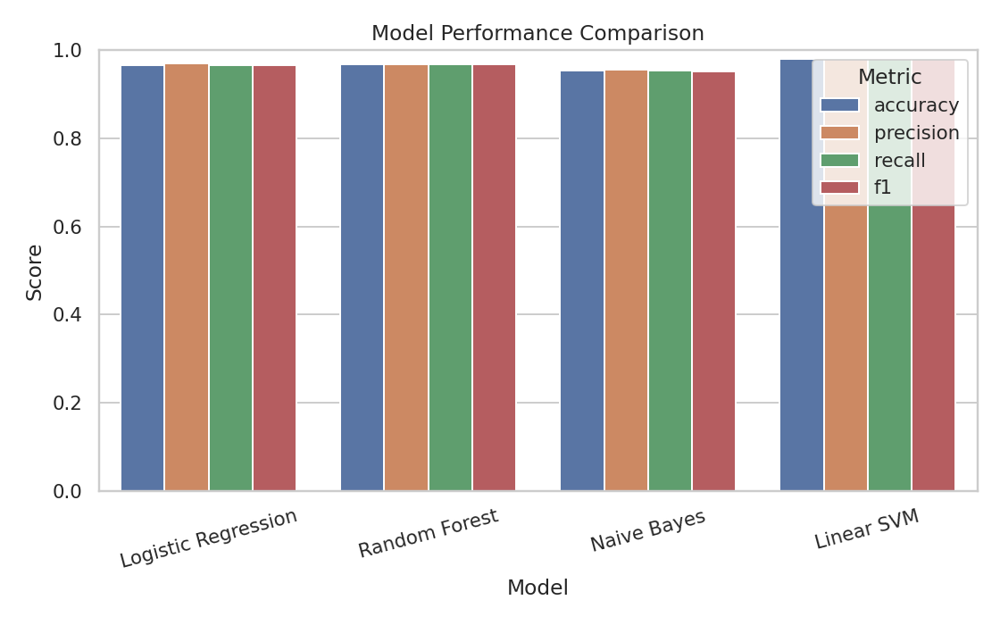
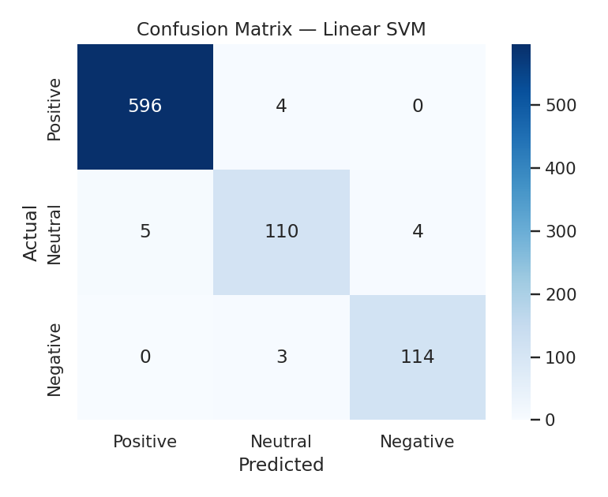
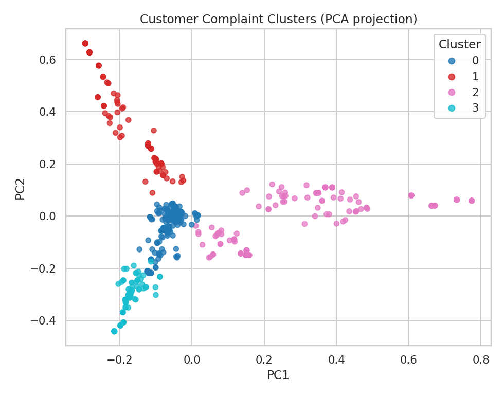
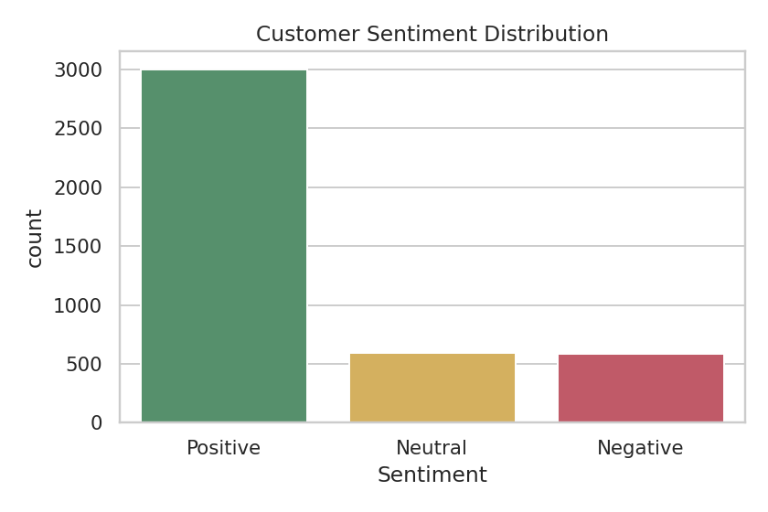
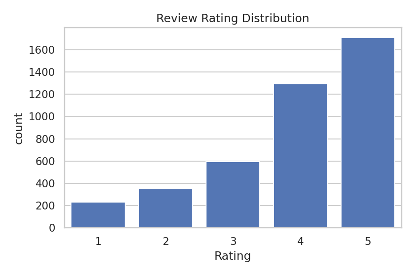
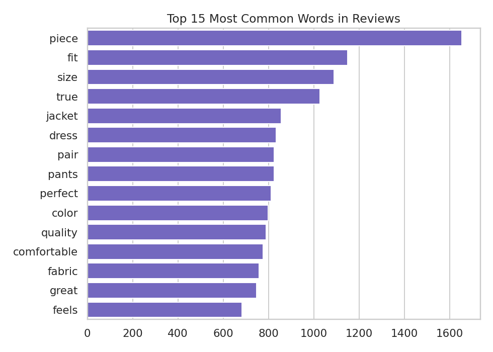

# 🛍️ AI Customer Feedback Intelligence System

> End-to-end NLP project that classifies customer sentiment, discovers recurring complaint themes, and serves everything through a live **Gradio** web app.

[](https://colab.research.google.com/github/YOUR_USERNAME/YOUR_REPO/blob/main/AI_Customer_Feedback_Gradio_Deployment.ipynb)


Graduation Project (Project 1) — **Artificial Intelligence Professional Diploma**.

<!-- After running the notebook, take a screenshot of the Gradio app, save it as images/gradio_demo.png, then uncomment the line below:

-->

---

## 📌 Problem

Online retailers collect thousands of written reviews. Reading each one to understand sentiment and root causes is slow, inconsistent, and doesn't scale. This project builds an AI system that:

1. **Classifies** each review as Positive / Neutral / Negative
2. **Clusters** negative reviews into complaint categories (sizing, fabric quality, shipping, price)
3. **Generates business insights** from the results
4. **Deploys** the model as an interactive web app

## 🚀 Quick Start

The whole project (data → training → deployment) lives in **one notebook**.

### Option A — Google Colab (easiest, gives a public link)
1. Click the **Open in Colab** badge above
2. **Runtime → Run all**
3. The last cell prints a public link like `https://xxxxx.gradio.live` — open it to use the app

### Option B — Run locally
```bash
git clone https://github.com/YOUR_USERNAME/YOUR_REPO.git
cd YOUR_REPO
pip install -r requirements.txt
jupyter notebook AI_Customer_Feedback_Gradio_Deployment.ipynb
```
Run all cells; the final cell launches the Gradio app. Open the local URL it prints.

## 🗂️ Data

> ⚠️ **The data in this repository is synthetic.** It was **generated by code** (`generate_data.py`), not downloaded from Kaggle or collected from real customers.

The project follows the structure of the public [Women's E-Commerce Clothing Reviews](https://www.kaggle.com/datasets/nicapotato/womens-ecommerce-clothing-reviews) dataset, so the synthetic file has the **same columns**: `Clothing ID, Age, Title, Review Text, Rating, Recommended IND, Positive Feedback Count, Division Name, Department Name, Class Name`.

Both versions of the data are included in the `data/` folder:

| File | Description | Rows |
|---|---|---|
| `data/reviews_raw.csv` | **Raw (uncleaned)** data exactly as generated. It deliberately contains **15 duplicate rows** and **40 missing values** (20 in `Review Text`, 20 in `Division Name`) to simulate real-world data-quality problems. | 4,215 |
| `data/reviews_clean.csv` | **Cleaned** data after removing duplicates and missing values, text cleaning (lowercase, punctuation/number removal, stopword removal), the `Sentiment` label, and the engineered features (`clean_text`, `review_length`, `word_count`, `exclaim_count`, `pos_lex_count`, `neg_lex_count`). | 4,180 |

**How the data was generated:** `generate_data.py` builds each review from sentiment-matched sentence templates (positive, neutral, and four complaint types: sizing, fabric quality, shipping, price), mixes in caveat sentences and neutral filler so vocabulary overlaps across classes, and uses a fixed random seed (`42`) so the output is fully reproducible. The same generation code is embedded in the notebook and produces an identical file.

```bash
python generate_data.py        # recreates data/reviews_raw.csv
```

**Important:** because the text is template-based, the model scores below are **much higher than you should expect on real-world reviews**. To use real data, download the CSV from Kaggle, save it as `data/reviews_raw.csv` (same column names), skip the data-generation cell in the notebook, and re-run.

## 🧠 Methodology

| Stage | What was done |
|---|---|
| **Data preparation** | Removed duplicates and missing values, lowercased text, stripped punctuation/numbers, tokenized, removed stopwords |
| **Labeling** | Rating 4–5 → Positive, 3 → Neutral, 1–2 → Negative |
| **NLP features** | TF-IDF (unigrams + bigrams, top 3,000 terms) |
| **Feature engineering** *(bonus)* | Review length, word count, exclamation count, positive/negative lexicon counts |
| **Classification** | Logistic Regression, Random Forest, plus Naive Bayes and Linear SVM *(bonus comparison)* |
| **Unsupervised learning** | K-Means (k=4) on TF-IDF of negative reviews, visualized with PCA |
| **Deployment** *(bonus)* | Gradio app with 3 tabs: Sentiment Classifier, Complaint Cluster Explorer, Insights Dashboard |

## 📊 Results

*(Measured on the synthetic dataset — see the Data section above.)*

| Model | Accuracy | Precision | Recall | F1 |
|---|---|---|---|---|
| Logistic Regression | 0.967 | 0.970 | 0.967 | 0.967 |
| Random Forest | 0.969 | 0.968 | 0.969 | 0.969 |
| Naive Bayes | 0.955 | 0.955 | 0.955 | 0.953 |
| **Linear SVM** | **0.981** | **0.981** | **0.981** | **0.981** |

<p align="center">
  
  
</p>

### Complaint clusters (K-Means on negative reviews)

| Cluster | Theme | Top terms |
|---|---|---|
| 0 | Price vs. quality | expensive, basic, material |
| 1 | Shipping & packaging | box, crushed, delayed, arrival |
| 2 | Sizing & fit | runs, small, return |
| 3 | Fabric quality | cheap, poor quality |

<p align="center">
  
</p>

### Exploratory analysis

<p align="center">
  
  
  
</p>

## 💡 Business Insights

- ~72% of reviews are positive and ~77% of customers recommend the product — a strong baseline to protect.
- Negative feedback concentrates around **sizing/fit** and **fabric quality**, giving buying and QA teams concrete priorities.
- The pipeline can run continuously on new reviews, turning a manual audit into a live monitoring feed.

*(These insights describe the synthetic data; re-run on the real dataset before drawing real business conclusions.)*

## 📁 Repository Structure

```
├── AI_Customer_Feedback_Gradio_Deployment.ipynb   # Full pipeline + Gradio app (single file)
├── generate_data.py                               # Script that generates the synthetic dataset
├── data/
│   ├── reviews_raw.csv                            # Raw data (with duplicates & missing values)
│   └── reviews_clean.csv                          # Cleaned data + engineered features
├── requirements.txt
├── images/                                        # Charts used in this README
├── docs/
│   ├── AI_Customer_Feedback_Report.docx           # Project report
│   └── AI_Customer_Feedback_Presentation.pptx     # Presentation slides
├── LICENSE
└── README.md
```

## 🔭 Future Work

- Train on the full real Kaggle dataset and compare results
- Fine-tune a transformer model (e.g. DistilBERT) for sarcasm and mixed sentiment
- Permanent deployment on Hugging Face Spaces
- Drift monitoring as new product lines launch

## 🛠️ Tech Stack

Python · pandas · NumPy · scikit-learn · matplotlib · seaborn · Gradio

## 👤 Author

**Abdulrahman Khaled Hassan Garamon** — [LinkedIn]([https://linkedin.com/in/YOUR_PROFILE](https://www.linkedin.com/in/abdulrahman-khaled-garamon-5558aa31b)) · [GitHub](https://github.com/Garamoon)

## 📄 License

Released under the [MIT License](LICENSE).
